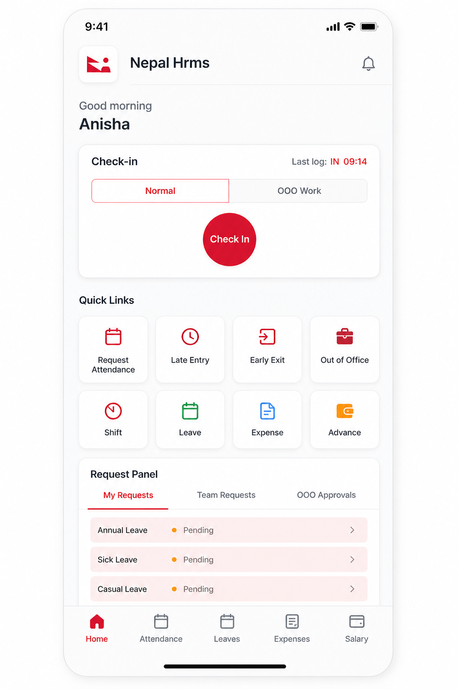
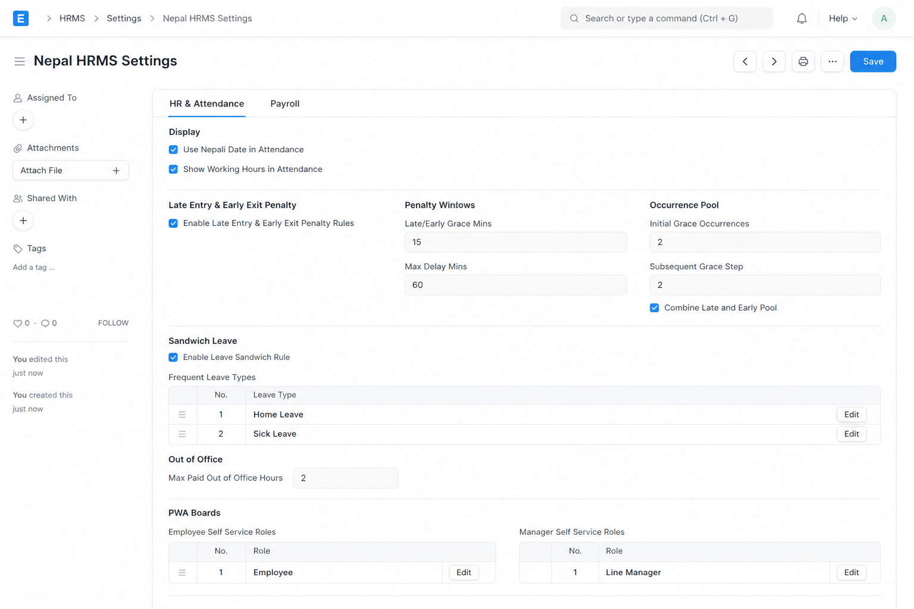
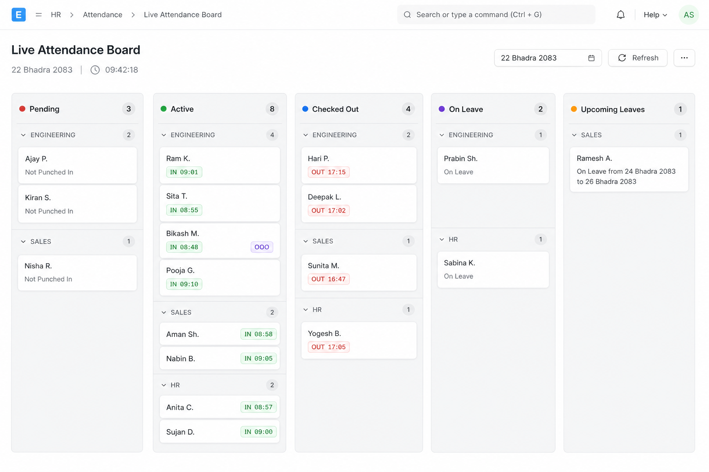
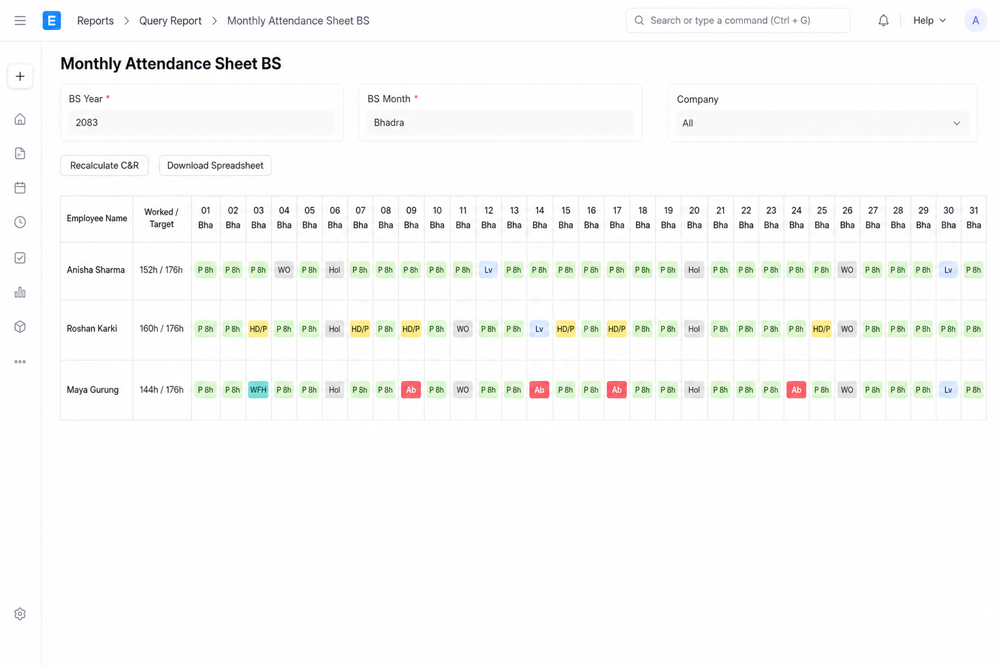

<h1 align="center">Nepal HRMS</h1>

<p align="center">
  Nepali HR and Payroll for <a href="https://github.com/frappe/hrms">Frappe HR</a> —
  Bikram Sambat dates, attendance policy, Nepal payroll, and the <strong>BSHRMS</strong> employee PWA.
</p>

<p align="center">
  
  
  
  
  
</p>

**Nepal HRMS** (`nepal_hrms`) is a Frappe app that localizes Frappe HR for Nepal: BS calendars, late/early/OOO policy, sandwich leave, SSF/PF payroll, and a mobile PWA at `/hr`.

Desk home is the **Nepal HRMS** workspace. The **BS HRMS** tile on the Apps screen opens the employee PWA.

---

## Screenshots

### BSHRMS

Employee PWA at `/hr` (the route is a Nepal HRMS setting; `/bshrms` redirects to it): a live clock with the Nepali date, check-in (Normal or OOO Work), quick links, and the request panel. Screenshots use made-up employees.

<p align="center">
  
</p>

### Nepal HRMS Settings

Single DocType that drives attendance penalties, sandwich leave, PWA board roles, Nepal payroll, and where notifications go.



### Live Attendance

Kanban of Pending / Active / Checked Out / On Leave / Pending Approvals / Upcoming, grouped by department, with BS date and punch chips.



### Report BS

**Monthly Attendance Sheet BS** — BS-month grid with P / HD / WO / Hol / Lv / Ab / WFH pills and worked vs target hours. Buttons: Time Bar Legend, Recalculate C&R, Download Spreadsheet.



---

## Dependencies

Install in this order on Frappe v15:

1. [ERPNext](https://github.com/frappe/erpnext)
2. [Frappe HR](https://github.com/frappe/hrms) (`hrms`)
3. [Nepal Compliance](https://github.com/rs0404/nepal-compliance) (`nepal_compliance`) — shared AD↔BS date libraries
4. Nepal HRMS (`nepal_hrms`)

```bash
bench get-app hrms
bench get-app nepal_compliance
bench get-app nepal_hrms
bench --site [site] install-app nepal_hrms
```

HR and payroll overrides live in this app only. After merging upstream Nepal Compliance, drop any payroll/HR files that land in `nepal_compliance` so both apps do not override the same DocTypes. See [docs/upstream-sync.md](docs/upstream-sync.md).

---

## Features

### BSHRMS (employee PWA)

Route: `/bshrms`. Installable as a PWA (manifest + service worker). App permission: active Employee, or Employee read.

**Tabs**

| Tab | What it does |
| --- | --- |
| Home | Check-in, quick links, OOO work logs, request inbox |
| Attendance | BS/AD calendar, Live/Leave board, CNR pools, monthly application counts |
| Leaves | Balances, request leave, holidays |
| Expenses | Expense claims |
| Salary | Salary slips and year-to-date |

**Home**

- Check-in gated by HR Settings “allow employee check-in from mobile app”
- Optional geolocation map when geolocation tracking is on
- Attendance type: **Normal** or **OOO Work** (reason required for OOO)
- IN/OUT alternation; last log time
- BS + AD date on the check-in modal
- Quick links: Attendance Request, Late Entry, Early Exit, Out of Office, Shift, Leave, Expense, Advance, Salary Slips
- **Request panel:** My Requests, Team Requests (approver inbox), OOO Approvals (include/reject OOO time)

**Attendance**

- Toggle **Cal** / **Live** (Live is role-gated)
- Calendar **BS** (Nepali) or **AD**
- Day sheet: related applications and create leave
- Sandwich-rule warning before leave from the calendar
- Select future working days; gapped days create **separate draft Leave Applications**
- Search other employees’ calendars when allowed
- Late/early pool summary (late days, early exits, free remaining, half-days, full-day escalation)
- Monthly application counts: Late Entry, Early Exit, Out of Office, Leave, Attendance Request — Approved / Rejected / Pending
- Lists of attendance requests, CNR apps, recent check-ins, hours summary
- Refresh after saving leave so the calendar repaints

**Live / Leave board (in PWA)**

- Pending, Active, Checked Out (live check-in columns)
- On Leave, Upcoming, Pending Leave
- Grouped by department; BS date picker
- Past dates need calendar-history permission
- Leave-board-only roles see leave columns only

**Leave**

- Frequent leave-type chips with remaining (allocation minus Open drafts)
- Types with zero remaining are hidden/disabled; LWP stays selectable
- Split leave: discontinuous selected days → one draft application per contiguous stretch
- Save is blocked when this application plus other Open drafts of that type exceed remaining (LWP not blocked)
- Cancel own leave

**Other PWA screens**

- Login, invalid-employee fallback, profile, notifications (mark read / all, push settings)
- App settings: enable/disable push
- Attendance Requests, Shift Requests, Shift Assignments, Employee Check-ins, Attendance list
- Late Entry / Early Exit / Out of Office application list and forms
- Expense Claims, Employee Advances, Salary Slip detail
- Install prompt, Ionic shell, translations
- Home paints from cache first, then revalidates

**PWA access (from Settings role tables; empty table = feature off)**

| Flag | Settings table |
| --- | --- |
| Live board | `pwa_live_board_roles` |
| Leave board | `pwa_leave_board_roles` (also inherits live roles) |
| Past attendance | `pwa_calendar_history_roles` |
| Others’ calendars | `pwa_calendar_view_others_roles` |

---

### Nepal HRMS Settings

Single DocType. Three tabs.

**HR & Attendance**

| Setting | Purpose |
| --- | --- |
| Use Nepali date in attendance | Show/store BS date on attendance UI |
| Show working hours in attendance | Display worked hours |
| Enable late/early penalty | Master switch for the CNR penalty engine |
| Late/early grace minutes | Free minutes after shift start / before end (default 15) |
| Max delay minutes | Beyond this → immediate half-day unless excused (default 60) |
| Initial grace occurrences | Free pool hits before first half-day (default 2) |
| Subsequent grace step | Free hits after a half-day before the next (default 2) |
| Combine late and early pool | One monthly pool for late + early |
| Full-day escalation | Escalate pool penalties to full-day absent after N occurrences |
| Application deadline | Max days after attendance to file Late/Early apps |
| Sandwich leave rule | Weekends/holidays between leave/absent → Absent + payroll deduct |
| Block sandwich leave application | Reject leave apps that would create a sandwich |
| Frequent leave types | PWA leave shortcuts |
| Max paid OOO hours | Personal OOO hours/day before half-day (default 2) |
| Continuous LWP gross deduction | Long single LWP application → gross LWP rate |
| Continuous LWP threshold days | Length that triggers gross LWP |
| Prevent self-approval | Attendance Request, OOO check-ins, CNR applications |
| PWA live / leave / history / others roles | Who can see boards and other calendars |
| Last BS allocation year/month | Watermark for the monthly BS leave job (read-only) |

**Payroll**

| Setting | Purpose |
| --- | --- |
| Daily rate basis | Fixed days / days in payroll period / days in BS month / working days in period |
| Fixed days | Divisor when basis is Fixed Days (default 30) |
| Half-day / unapproved absence / LWP deduction base | Which salary parts to deduct from |
| Period leave gross LWP | If LWP + absent exceed threshold, LWP at gross (paid leave excluded) |
| Default basic percent | When only Base is entered, Basic = this % (SSF ≥ 60%) |
| Include grade / DA in SSF base | Contribution base switches |
| Overtime rate multiplier | Default 1.5× (Labour Act) |
| Default leave encashment formula | Prefill on structure/assignment (e.g. `custom_basic_remuneration / 30`) |
| Payroll period basis | Nepali month or custom day range |
| Payroll period start day | BS start day for custom range (1–29) |
| Minimum wage | Monthly basic / DA / total, daily, hourly floors |
| Payroll accounts | Per-company GL mapping by purpose |
| On variant mismatch | Additional Salary naming the opposite Wages/Salary component: Block or Warn |
| Scheduled payroll | Daily job creates Payroll Entries on a BS day; entry only / +slips / +submit slips; notify role |
| Run payroll setup | Create components, four salary structures, tax slab |

Deduction base options: Basic only · +Grade · +DA · +Grade+DA · Basic remuneration (SSF/PF) · Total fixed remuneration (gross).

**Notifications**

One event list, two delivery channels. Each row picks who is notified, then whether it
goes to Raven, the BSHRMS PWA, or both. Every event starts disabled.

| Setting | Purpose |
| --- | --- |
| Bot source / Raven bot | Reuse an existing Raven Bot or create one; required before any channel is made |
| Channel source / Raven channel | Reuse a channel or create one for events with Channel ticked |
| Channel type / workspace | Public or Private, and which Raven Workspace to create it in |
| Channel member roles | Roles whose Raven Users are added to the channel on each save |
| Enable PWA notifications | Master switch for the PWA channel; off until switched on |
| Attendance notifications | Per-event: Enabled, Channel, Employee, Reports To, Approver, PWA, message override |

The Raven channel is created lazily: it appears only once a row is enabled with Channel
ticked and its own Channel field left empty, and only when a bot resolves. Raven direct
messages are skipped for anyone who is not a Raven User; PWA notifications are not, since
they go to the employee's own user. Leave Application is excluded from the PWA channel —
HRMS notifies its approver and applicant already.

---

### Live Attendance

**Desk page** `live_attendance_boar-1` — *Live Attendance Board*

- Kanban: Pending, Active, Checked Out, On Leave, Upcoming Leaves (plus pending leave where shown)
- Department fold groups
- Server clock and full BS date in the header
- Punch hover timeline (`09:30 IN → 13:00 OUT → 14:00 IN`)
- OOO tag on OOO Work check-ins
- Refresh without full page reload
- Roles: Attendance Report Viewer (and PWA role tables for the mobile board)

**PWA** reuses the same data (`get_pwa_live_attendance`) with the Cal/Live toggle.

---

### Report BS

**Monthly Attendance Sheet BS** (script report on Attendance)

- Columns labeled `DD MON` in the BS month (e.g. `01 Baisakh`)
- Employee name, worked/target hours, then one column per BS day; Employee ID last
- Pills: **P** present (hours), **HD/P** half day, **WO** weekly off, **Hol** holiday, **Lv** leave, **Ab** absent, **WFH** work from home
- Target hours: 8.0 standard, 4.0 half day, 0 on holiday/WO/leave/absent
- Work on a weekly off is tracked but does not add to target
- Filters: BS year/month, custom period, employee
- **Recheck Attendance…** re-applies late/early, holiday, sandwich and half-day leave rules to chosen days, previewing every change first; BS presets
- **Download Spreadsheet…** daily columns or full data (logs, late/early mins, leave & apps)
- Permissions: HR Manager / HR User see company; Attendance Report Viewer sees company; Employee sees self and recursive subordinates

Salary slips also show `nepali_start_date` / `nepali_end_date`. There is no separate BS payroll report DocType.

---

### Attendance policy

- Late/early minutes from shift bounds vs first IN / last OUT
- Grace window, max-delay half-day, monthly occurrence pool, optional full-day escalation
- Excused by approved Late/Early app, half-day leave, or Office Work type
- Attendance flags `custom_cnr_*` plus month counts
- CNR applications: Late Entry, Early Exit, Out of Office (Personal / Office Work). Employee creates → Leave Approver / HR submits → attendance is recalculated. Deadline and self-approval rules apply
- OOO application sets `custom_ooo_hours`; personal hours above max → half-day
- **OOO Work check-ins:** geofence bypass, GPS path logs (`Employee Path Log`), attendance on hold until manager includes or rejects time
- Sandwich: holidays/weekends between full leave/absent → Absent
- **Attendance Policy Escape:** skip sandwich, late/early, continuous LWP gross, absent gross, and/or application requirement per employee/date (bulk assign available)
- Custom mark-attendance: exclude unapproved OOO hours; OOO-hold attendance
- Attendance Request status Open/Approved/Rejected
- Desk: Recalculate Late/Early, bulk period recalculate with BS presets

See [docs/attendance.md](docs/attendance.md) and [docs/ooo_attendance_flow.md](docs/ooo_attendance_flow.md).

---

### Leave

- Default types: Annual Home Leave (18), Annual Sick Leave (12, carry/encash)
- Leave Type flag `allocate_leave_on_start_of_bs_month` with amount; scheduler runs on BS day 1
- Leave Policy Assignment override for BS-aware assignment
- Sandwich validation on Leave Application (warn or block)
- Open/draft applications consume remaining balance (except LWP)
- Frequent leave types on the PWA
- Split leave from calendar gaps
- Cancel own leave
- BS from/to fields on Leave Application, Allocation, Period, Policy, Encashment

---

### Payroll

- **Salary structures** (setup button): Nepal Payroll — SSF × Salary/Wages, Nepal Payroll — PF & Gratuity × Salary/Wages. Components include Basic, DA, Grade, Overtime, leave and late deduction, TDS, CIT, SSF/PF/Gratuity (employer + employee), insurance, adjustments
- **Salary Structure Assignment** breakdown: Basic, DA, Grade, Other Allowances table (`nsa_<abbr>`), computed Basic Remuneration / Total Fixed → Base. Minimum wage check. Leave encashment formula
- **Salary Slip:** Nepal attendance deductions, sandwich absents, period/continuous LWP gross, tax and retirement projection (assessable, 1/3, NPR 500,000 ceiling, CIT from Employee CIT Contribution), OT hours, period divisor snapshot, HTML explanation, BS dates
- **Payroll Entry:** suggested BS period dates, salary-structure filter, created-by-scheduler flag
- **Scheduled payroll:** one run per salary structure on a BS day
- **Nepal Payroll Period Override:** override day-count for a BS month (snapshotted on slips)
- **Employee CIT Contribution:** effective-dated monthly CIT election
- Festival allowance via Employee Benefit Claim from revised/gross salary
- Daily job also syncs the current BS date into Nepal Compliance Settings

---

### DocTypes

| DocType | Purpose |
| --- | --- |
| Nepal HRMS Settings | Single config |
| Nepal HRMS Role | Child: PWA ACL role rows |
| Nepal HRMS Frequent Leave Type | Child: leave-type shortcuts |
| Nepal HRMS Raven Notification | Child: one row per notification event |
| Nepal Salary Slip Earning Component | Child: extra earning components on the slip print |
| Late Entry Application | Excuse late arrival |
| Early Exit Application | Excuse early exit |
| Out of Office Application | Declare OOO window |
| Attendance Policy Escape | Per-employee/date policy skips |
| Employee Path Log | GPS breadcrumbs during OOO |
| Employee CIT Contribution | CIT election for TDS |
| Nepal Payroll Period Override | BS month day-count override |
| Nepal Payroll Account | Company + purpose → GL |
| Nepal Salary Allowance | SSA other allowances |
| Nepal Scheduled Payroll | Scheduled payroll run rows |

---

### Roles and permissions

| Role / rule | Use |
| --- | --- |
| Attendance Report Viewer | Monthly Attendance Sheet BS and Live Board |
| System Manager / HR Manager | Settings, Policy Escape, full CNR |
| HR User | CNR submit, CIT/period override read |
| Employee | Create CNR; path log read |
| Leave Approver | Submit/cancel CNR; OOO check-in approval |
| PWA role tables | Live board, leave board, calendar history, view others |
| Self-approval settings | Attendance Request, OOO check-ins, CNR |

---

### Desk UI

**Workspace** shortcuts: Nepal HRMS Settings, Live Attendance Board, Monthly Attendance Sheet BS, Late Entry / Early Exit / Out of Office Application, Salary Slip, Payroll Entry. Cards: Attendance, Payroll, Settings, Reports & Dashboards.

**Dashboards:** Attendance connects check-ins and CNR apps; Employee connects Policy Escape and CIT.

**Desk scripts:** BS dates on Salary Slip and Payroll Entry; SSA breakdown and encashment; Recalculate Late/Early and bulk Recheck Attendance; CNR form helpers; leave allocation BS UI; festival claim; workspace icon patch.

**Custom fields** (high-signal): Salary Slip tax + attendance deduction + OT + BS dates + CIT + divisor snapshot; Attendance nepali_date, OOO hold/hours, late/early mins, CNR flags; Employee Checkin attendance type and approval; SSA Nepal breakdown; Leave Type BS monthly allocation; Payroll Entry BS dates and scheduler flag; BS dates on Expense Claim, Advances, Shifts, and related HR docs.

---

### Automation

Daily scheduler:

1. Sync BS date and allocate monthly leave on BS day 1
2. Clean up old OOO path logs (retention from HR Settings)
3. Run scheduled payroll

Install / migrate: custom fields on every migrate; salary structures, default leave types, and roles after sync.

---

## License

Nepal HRMS is free software under the **GNU General Public License v3 or later**. You may redistribute and modify it under the terms of the GPL. There is **no warranty**.

- Full license text: [LICENSE](LICENSE)
- Copyright holder and short notice: [NOTICE](NOTICE)
- SPDX: `GPL-3.0-or-later`

---

## Related docs

- [Attendance & Report BS](docs/attendance.md)
- [OOO Work flow](docs/ooo_attendance_flow.md)
- [Upstream Nepal Compliance sync](docs/upstream-sync.md)
- [Pre-release notes](PRE-RELEASE.md)
