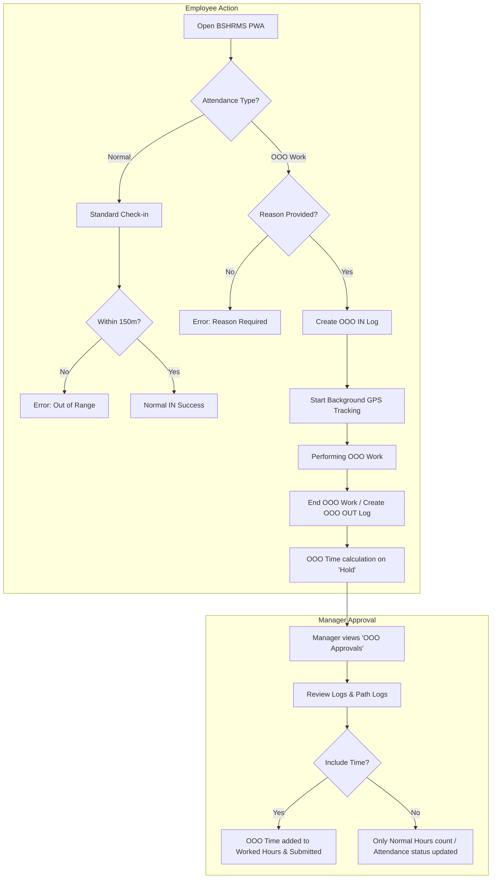

# Attendance Workflow Documentation: Normal vs. Out-of-Office (OOO)

This document explains the localized attendance workflows implemented in the BSHRMS PWA, focusing on the newly added "Out of Office Work" feature and its integration with the standard Frappe HRMS flow.

---

## 1. Workflow Comparison

| Feature | Previous Flow (Normal) | New Flow (OOO Work) |
| :--- | :--- | :--- |
| **Geofencing** | Strict (150m radius) | Bypassed |
| **Mandatory Fields** | None | OOO Reason (Mandatory for both IN and OUT) |
| **Approval** | Automatic (Shift-based) | Manager Approval for Time Inclusion |
| **Tracking** | Point-in-time (Check-in/out) | Continuous (GPS Path Logging) |
| **Live Board** | IN / OUT | OOO IN / OOO OUT + 'Out of Office' Tag |
| **Status Label** | IN / OUT | OOO IN / OOO OUT |

---

## 2. Attendance Flow Diagram

---

## 3. Detailed Process Steps

### A. Initiating OOO Work
1.  The employee selects **"OOO Work"** from the Check-in panel.
2.  A **Reason** is mandatory for both starting (IN) and ending (OUT) OOO work.
3.  Upon submission, the system records the log with log type `IN` and custom type `OOO Work` (OOO IN).
4.  The PWA begins periodic GPS reporting to the `Employee Path Log` Doctype.

### B. Background Tracking
1.  While the OOO session is active, the PWA sends coordinates every 5 minutes (configurable in HR Settings).
2.  This creates a breadcrumb trail for audit purposes, compensating for the lack of geofencing.

### C. Ending OOO Work
1.  The employee returns to the office or finishes the task and selects **"OOO Work"** again, which acts as a check-out (`OUT` log).
2.  The system calculates total working hours but marks the `Attendance` record as `custom_ooo_hold = 1` (on hold pending manager approval).

### D. Transition Validation Rules
To maintain database integrity and ensure accurate working hours calculation, a strict check-in and check-out alternating sequence (`IN` -> `OUT` -> `IN` -> `OUT`) is enforced on both the front-end and back-end:
- **OOO Session**: Must start with `OOO IN` and end with `OOO OUT`.
- **Normal Session**: Must start with `Normal IN` and end with `Normal OUT`.
- **Mismatched transitions** are blocked.
  - *Example 1 (Start OOO, return to office)*: If an employee starts the day out of office (`OOO IN`), they must first do an `OOO OUT` checkout when they arrive at the office before they can perform a `Normal IN` check-in.
  - *Example 2 (Already in office, leaving for OOO)*: If already checked in normally (`Normal IN`), to start out-of-office work they must first checkout (`Normal OUT`) and then check-in as `OOO IN`.

### E. Approval Workflow
1.  The manager/approver sees the request in the **"OOO Approvals"** tab of the Request Panel.
2.  The manager decides whether to **Include OOO Time** in the day's total worked hours.
3.  If approved:
    -   The OOO hours are added to any existing Normal worked hours.
    -   The `Attendance` record is recalculated and submitted (or updated directly if already submitted).
    -   If no normal logs exist, the status is set to **"Present"** (based on approved OOO hours).

---

## 4. Current Issues & Potential Improvements

### Known Issues
-   **Battery Optimization**: Modern mobile operating systems (iOS/Android) may kill background GPS tracking if the PWA is not kept "active" or if power-saving mode is on.
-   **Manual Dependency**: The flow relies on the employee remembering to "End OOO Work". If they forget, the tracking continues and the attendance remains on hold indefinitely.

### Suggestions for Improvement
1.  **Geofence Reminders**: Implement a push notification or local alert when the employee leaves the company's geofence but hasn't toggled OOO status.
2.  **Path Visualization**: Add a "View Path" button in the OOO Approval item that opens a map showing the GPS breadcrumbs for that specific session.
3.  **Automatic End**: Implement a "Max OOO Duration" (e.g., 10 hours) after which the tracking automatically stops and the session is flagged for review.
4.  **Offline Support**: Cache GPS coordinates if internet connectivity is lost during OOO work and sync them once back online.

---

*Document Version: 1.2 (Localized for Nepal Compliance)*
